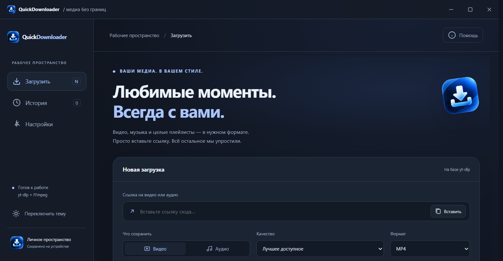
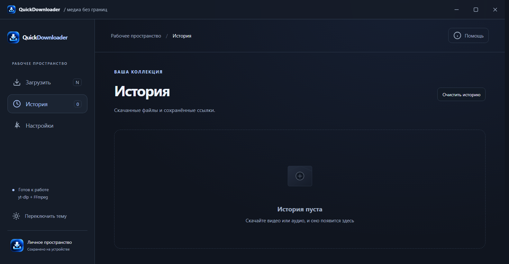
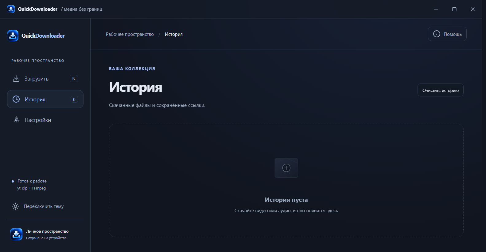

# QuickDownloader

Windows-приложение для сохранения видео и аудио с помощью [yt-dlp](https://github.com/yt-dlp/yt-dlp) и [FFmpeg](https://ffmpeg.org/). Поддерживает выбор качества и формата, плейлисты, историю загрузок, системный трей и три темы оформления.



## Возможности

- Видео и аудио: MP4, WebM, MKV, MP3, M4A, FLAC и WAV.
- Прогресс загрузки, отмена, открытие сохранённого файла.
- История, папка загрузок и настройки поведения.
- Темы «Полночь», «Облако» и «Лес» с анимацией смены.
- Автоматическая загрузка yt-dlp и FFmpeg при первом запуске. Для неё нужен интернет.
- Установщик Windows с ярлыками и выбором папки.

## Запуск и сборка

Требуются Windows 10/11, Node.js и npm.

```powershell
npm ci
npm start
```

```powershell
npm test
npm run build
```

Установщик появится в `dist-installer/`. Файлы yt-dlp и FFmpeg загружаются в пользовательскую папку приложения при первом запуске, а не включены в установщик. Скачивайте только контент, на сохранение которого у вас есть права.

## Интерфейс

| История | Настройки |
| --- | --- |
|  |  |

## Архитектура

`main.js` управляет окном, треем, настройками и yt-dlp. `preload.js` предоставляет ограниченный IPC-интерфейс. `src/` содержит интерфейс. Установка создаётся через electron-builder/NSIS. Данные истории и настроек хранятся локально через electron-store.

Установщик пока не подписан цифровой подписью. Проект распространяется по лицензии MIT.
